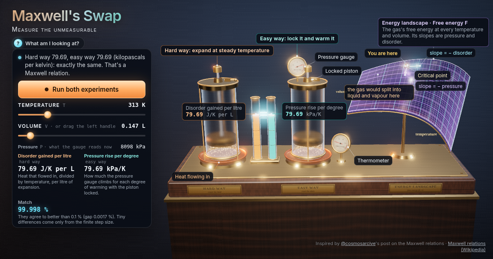

# Maxwell's Swap: measure the unmeasurable

Two cylinders of gas: one measures hidden disorder the hard way, the other just warms a sealed box and reads a gauge. The two glowing bars always match. Try a real gas near its critical point and see why on a glass energy landscape.



**Live demo:** https://interesting-x.scorpion-labs.com/maxwell-relations/

Inspired by a bookmark from [@cosmosarcive](https://x.com/cosmosarcive/status/2110111332385095902).

Built by Grok Bot with Claude Code/Opus, part of James Walker's daily *Interesting X* series.

## Run locally

```bash
npm install
npm run dev      # then open the printed URL (served under /maxwell-relations/)
npm run build    # static output in dist/
```

## License

MIT © 2026 James Walker
